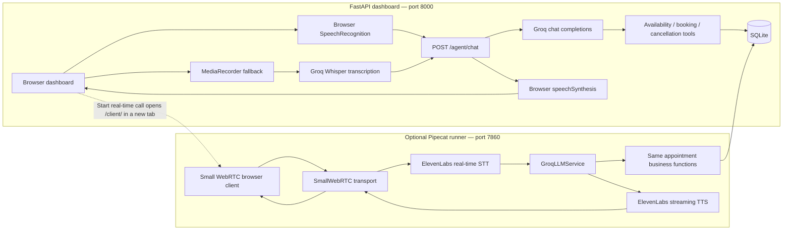

# MediVoice AI

MediVoice AI is a local clinic-receptionist demo. It provides a FastAPI backend, a browser dashboard, SQLite-backed doctor availability and appointment operations, Groq text chat, browser voice input/output, and an optional Pipecat WebRTC voice runner.

The assistant is for scheduling only. It must not diagnose, prescribe, or give treatment advice. Do not enter real patient information.

## Features

- View seeded doctors and query available appointment slots by speciality and date.
- Book and cancel appointments through the dashboard or assistant tools.
- Validate phone numbers and require an explicit confirmation before assistant cancellations.
- Prevent double-booking and reject past appointment slots.
- Use Groq chat completions with `openai/gpt-oss-120b` by default; `GROQ_MODEL` can override it.
- Use browser speech recognition and speech synthesis where supported.
- Fall back to a recorded audio upload and Groq Whisper transcription when browser speech recognition is unavailable.
- Optionally run a separate Pipecat WebRTC client with ElevenLabs real-time STT/TTS and Groq LLM tools.

## Architecture

The normal dashboard and optional Pipecat WebRTC runner are separate voice experiences:



### Voice pipeline details

- **Dashboard voice input:** The browser uses its own `SpeechRecognition` implementation when available. Otherwise, `MediaRecorder` captures a clip, `/voice/transcribe` sends it to Groq's `whisper-large-v3-turbo`, and the transcript is sent through the same `/agent/chat` endpoint as typed messages.
- **Dashboard voice output:** Replies are displayed as text and spoken using the browser's `speechSynthesis`. The dashboard does not use ElevenLabs for this path.
- **Pipecat real-time path:** `backend/bot.py` uses Pipecat `SmallWebRTC` input/output, `ElevenLabsRealtimeSTTService`, `GroqLLMService`, and `ElevenLabsTTSService`. It registers doctor availability, booking, and cancellation tools backed by the same SQLite business functions. The dashboard's **Start real-time call** link opens Pipecat's separate prebuilt WebRTC UI in a new tab. Run both processes to use it.
- If a Pipecat booking or cancellation fails, the tool result suppresses another LLM completion and sends a fixed failure message instead of relying on the model to phrase the outcome correctly.
- Browser speech recognition, the recording fallback, and the Pipecat audio pipeline are distinct implementations. Automated tests mock Groq and use isolated SQLite; no live Groq, microphone, ElevenLabs STT/TTS, or end-to-end Pipecat audio test has been verified for this project.

## Technology stack

- Python 3.10+
- FastAPI, Pydantic, HTTPX
- SQLAlchemy and SQLite
- Groq OpenAI-compatible chat-completions API and Whisper transcription API
- Optional Pipecat 0.0.108 WebRTC pipeline with the ElevenLabs STT/TTS services
- Plain HTML, CSS, and JavaScript; no frontend build step

The dashboard's chat and transcription endpoints call Groq over HTTPX; they do not require the Groq Python SDK. The optional Pipecat runner uses Pipecat's Groq service. `requirements-pipecat.txt` pins the optional Pipecat packages separately from the core backend.

## Windows setup

Run these commands in PowerShell:

```powershell
cd D:\medivoice-ai\backend
python -m venv .venv
.\.venv\Scripts\Activate.ps1
python -m pip install -r requirements-dev.txt
Copy-Item .env.example .env
```

If PowerShell blocks activation, use the venv interpreter directly:

```powershell
.\.venv\Scripts\python.exe -m pip install -r requirements-dev.txt
```

Edit `backend/.env` and add a Groq API key for AI chat and recorded-audio transcription. The ElevenLabs key is only needed for the optional Pipecat runner. Never put real keys in source files, frontend assets, documentation, or `.env.example`.

### Environment variables

| Variable | Required for | Description |
| --- | --- | --- |
| `GROQ_API_KEY` | Chat and recorded-audio transcription | Groq API credential. |
| `GROQ_MODEL` | Optional | Groq chat model; defaults to `openai/gpt-oss-120b`. |
| `ELEVENLABS_API_KEY` | Optional Pipecat voice runner | ElevenLabs API credential for real-time STT and TTS. |
| `ELEVENLABS_VOICE_ID` | Optional Pipecat voice runner | ElevenLabs voice ID; the application has a demo default if this is empty. |
| `DATABASE_URL` | Optional | SQLAlchemy URL; defaults to the absolute `backend/medivoice.db` SQLite path. |
| `DASHBOARD_HOST` | Optional | FastAPI bind address; defaults to `127.0.0.1`. |
| `DASHBOARD_PORT` | Optional | FastAPI port; defaults to `8000`. |
| `PIPECAT_HOST` | Optional Pipecat voice runner | Pipecat bind address; defaults to `127.0.0.1`. |
| `PIPECAT_PORT` | Optional Pipecat voice runner | Pipecat runner port; defaults to `7860`. |
| `PIPECAT_CLIENT_HOST` | Optional Pipecat voice runner | Hostname used by the dashboard to open the Pipecat client; defaults to `127.0.0.1`. |
| `PIPECAT_CLIENT_PATH` | Optional Pipecat voice runner | Client route; defaults to `/client/`. |

`backend/.env.example` contains empty credential fields and non-secret configuration only. The ignore rules cover `.env` files, new local databases, audio samples, Python caches, certificates, and token/credential files.

### Database and seed data

The backend creates tables on startup and seeds four demo doctors plus future appointment slots if needed. Seeding is idempotent and preserves existing bookings. SQLite foreign-key checks are enabled for new database connections. The normal application database is `backend/medivoice.db`; set `DATABASE_URL` to use another SQLAlchemy database. No separate migration or seed command is required.

The repository also contains a legacy, already-tracked root-level `medivoice.db`. The backend does not use it; it has no appointment rows and is retained rather than deleted as part of this cleanup. The active `backend/medivoice.db` is ignored and was left untouched.

## Run the dashboard backend

From `D:\medivoice-ai\backend` with the virtual environment active:

```powershell
python -m uvicorn app.main:app --reload
```

- Dashboard: <http://127.0.0.1:8000>
- API documentation: <http://127.0.0.1:8000/docs>
- Health check: <http://127.0.0.1:8000/health>

The dashboard's typed availability, booking, and cancellation flows work without provider credentials. AI chat and recorded-audio transcription require `GROQ_API_KEY`.

## Run the dashboard and real-time voice runner

The dashboard API and Pipecat WebRTC runner are separate processes. Starting
Uvicorn alone does **not** start the voice server. To start both without
launching duplicates, run this from PowerShell:

```powershell
cd D:\medivoice-ai\backend
.\start_services.ps1
```

The script reuses a healthy service already on its configured port and refuses
to start another process when a port is occupied by an unrecognized service.
It checks that `GROQ_API_KEY` and `ELEVENLABS_API_KEY` are present without
printing their values. Keep both launched service windows open.

The core backend supports Python 3.10+. Pipecat 0.0.108 requires Python 3.11+
and the Pipecat environment must be installed separately. One-time setup:

```powershell
cd D:\medivoice-ai\backend
py -3.12 -m venv .venv-pipecat
.\.venv-pipecat\Scripts\Activate.ps1
python -m pip install -r requirements-pipecat.txt
```

Alternatively, start each process in its own PowerShell window. From
`D:\medivoice-ai\backend`, run Uvicorn in one window:

```powershell
.\.venv\Scripts\Activate.ps1
python -m uvicorn app.main:app --host 127.0.0.1 --port 8000
```

In the second window:

```powershell
cd D:\medivoice-ai\backend
.\.venv-pipecat\Scripts\Activate.ps1
python bot.py -t webrtc --host 127.0.0.1 --port 7860
```

The Pipecat runner serves its prebuilt client at <http://127.0.0.1:7860/client/>.
The dashboard's **Start real-time call** link checks that client first; if the
runner is unavailable, it shows setup instructions instead of navigating to a
refused port. When available, it redirects to the configured Pipecat client.
Allow microphone access and use the client's start/stop controls. The real-time
path requires both `GROQ_API_KEY` and `ELEVENLABS_API_KEY`, a valid
`ELEVENLABS_VOICE_ID`, and network access to both providers.

The local defaults are dashboard `127.0.0.1:8000` and Pipecat
`127.0.0.1:7860`. Configure `DASHBOARD_HOST`, `DASHBOARD_PORT`, `PIPECAT_HOST`,
`PIPECAT_PORT`, `PIPECAT_CLIENT_HOST`, and `PIPECAT_CLIENT_PATH` in
`backend/.env` when needed. For access from another device, bind Pipecat to an
appropriate interface and set `PIPECAT_CLIENT_HOST` to a hostname reachable
from that device; configure firewall access accordingly.

To try the voice tools:

1. Ask for a speciality and future date.
2. Select a doctor/slot by speaking and provide the phone number.
3. Listen for the doctor, slot, and phone number read-back. Confirm naturally (for example, **“yes,” “go ahead,”** or **“that's correct”**). Questions preserve the pending booking; a negative response declines it.
4. To cancel, provide the appointment ID and phone number. The assistant reads back the appointment and asks for confirmation; confirm naturally (for example, **“yes, cancel it”** or **“go ahead”**). A cancellation is not executed until confirmation.
5. Use the Pipecat client's stop control to end the WebRTC session.

This procedure describes the intended flow; end-to-end microphone, transcription, tool-calling, and audio playback through Pipecat have not been tested live here.

## Dashboard workflows

### Check availability and book

1. Open <http://127.0.0.1:8000>.
2. Choose a speciality and future date, then select **Show available times**.
3. Enter a demo phone number and select an available slot.
4. Review the doctor, date/time, and phone number in the confirmation dialog, then accept to book.
5. The dashboard displays the server-confirmed appointment. A failed API operation is not shown as a successful booking.

### Cancel

1. Select **Cancel appointment** in the appointment card.
2. Review the appointment ID, doctor, and phone number in the confirmation dialog.
3. Confirm cancellation. The dashboard clears the card only after the backend confirms success.

The dashboard keeps the current appointment card in page memory; it is not an authenticated patient account or a persistent appointment search UI.

## API

- `GET /health` — database health check
- `GET /voice/realtime-health` — checks whether the separate Pipecat client is responding
- `GET /doctors/` — list doctors
- `GET /doctors/availability?speciality=Cardiology&date=YYYY-MM-DD` — open slots
- `GET /doctors/{doctor_id}/slots` — future open slots for a doctor
- `POST /appointments/book` — atomically reserve a future slot
- `POST /appointments/{appointment_id}/cancel` — verify phone and release the slot
- `POST /agent/chat` — Groq chat with local availability/booking/cancellation tools
- `POST /voice/transcribe` — transcribe a recorded audio upload with Groq Whisper

## Tests

Run the backend tests from `D:\medivoice-ai\backend`:

```powershell
python -m pytest -q
```

The test suite uses isolated SQLite databases and mocked provider responses. It verifies API booking/cancellation, explicit assistant confirmations, concurrent slot claims, booking/cancellation rollback, SQLite foreign keys, provider error mapping, transcription validation, and dashboard HTML. These tests do not test real microphone permissions, browser speech APIs, live Groq responses, or live ElevenLabs audio.

## Troubleshooting

- **AI reports provider/model error:** Verify `GROQ_API_KEY` and `GROQ_MODEL` in `backend/.env`. The default model is `openai/gpt-oss-120b`. Provider diagnostics are logged without returning credentials to the browser.
- **Rate limited:** Wait for the provider's `Retry-After` interval before retrying.
- **No microphone prompt:** Grant browser microphone permission and use `localhost`/`127.0.0.1` or another secure context.
- **Recorded-audio transcription fails:** It requires `GROQ_API_KEY`, a supported audio recording, and a working Groq Whisper endpoint.
- **Pipecat client does not open:** Run `.\start_services.ps1` from `backend`, or start `python bot.py -t webrtc --host 127.0.0.1 --port 7860` in a second terminal. Confirm port 7860 is free and the runner window reports a successful startup. The runner needs both provider keys.
- **ElevenLabs rejects the voice:** Check the account's access to the voice ID and keep `ELEVENLABS_VOICE_ID` set to a valid voice.
- **Dashboard shows no appointments:** Select a future date and speciality with seeded slots. Startup seeding fills the upcoming seven-day window.
- **Backend import/startup failure:** Activate the backend venv and install `requirements-dev.txt`; install `requirements-pipecat.txt` only for the separate runner.

## Security and known limitations

- This is a local demo, not a production medical-record system. Do not enter real patient data.
- There is no user login, SMS/OTP phone ownership verification, or authorization. Cancellation checks the supplied phone against the stored value, which is not proof of ownership.
- The default SQLite database is local. Back it up before replacing or deleting it.
- Pending assistant booking/cancellation confirmations are held in process memory for up to 30 minutes and are lost on restart; they are not tied to an authenticated patient account.
- Appointment operation routes are unauthenticated. The dashboard asks for confirmation, but this local demo must not be exposed as a public service.
- The browser's native speech recognition/synthesis may use browser- or OS-configured services.
- The dashboard browser voice path is turn-based; the separate Pipecat runner is the real-time WebRTC path.
- Pipecat's client runs on port 7860 separately from the dashboard on port 8000. Voice actions update the shared database, but a separate open dashboard tab does not receive a live push update.
- Appointment rescheduling is not currently implemented. A patient can cancel an appointment and book a different available slot.
- Actual browser microphone, Pipecat WebRTC, Groq API responses, ElevenLabs STT/TTS, and live booking/cancellation through audio remain unverified. Provider behavior is covered by mocked tests only.
